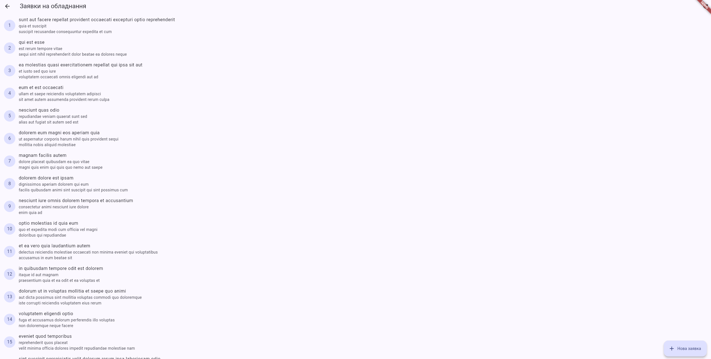
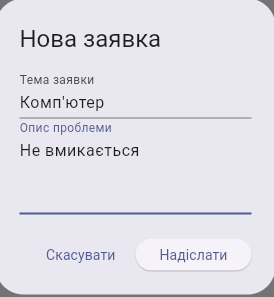
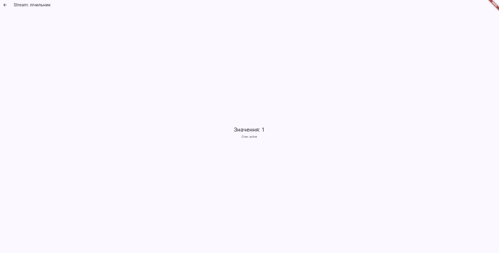
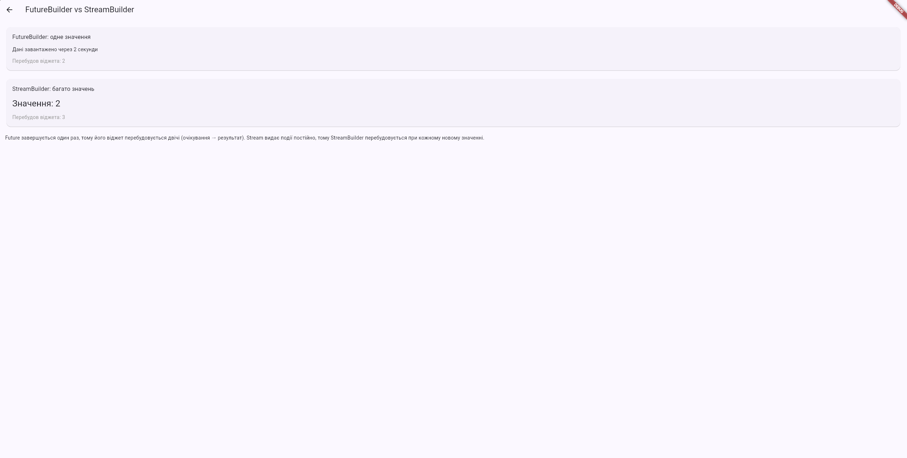

# lab6_async_rest

Лабораторна робота №6 з дисципліни «Сучасні технології проєктування».
Тема: асинхронність, Stream та REST API у Flutter.

Предметна область: облік обладнання комп’ютерної лабораторії коледжу (продовження лабораторної №5), заявки на обладнання.
Дані беруться з тестового API https://jsonplaceholder.typicode.com.

## Реалізований функціонал

- GET-запит `/posts` та відображення списку через `FutureBuilder`
  (стани: очікування, помилка, дані);
- POST-запит `/posts` для створення нової заявки (код відповіді 201);
- обробка помилок: HTTP-статус, тайм-аут, відсутність мережі;
  повідомлення користувачу через `SnackBar`;
- індикатор завантаження, кнопка повторного запиту (Retry);
- оновлення списку жестом `RefreshIndicator` (pull-to-refresh);
- власний потік (`StreamController`) і `StreamBuilder` з лічильником;
- екран порівняння `FutureBuilder` і `StreamBuilder` (потік на `async*`).

## Структура проєкту

```text
lib/
  main.dart
  models/post.dart
  services/api_service.dart      # getPosts, createPost
  services/async_demo.dart       # Future.delayed, async*-потік
  screens/home_screen.dart
  screens/posts_screen.dart
  screens/stream_screen.dart
  screens/compare_screen.dart
```

## Запуск

```bash
flutter pub get
flutter run -d chrome
```

У GitHub Codespaces: `flutter run -d web-server --web-port 8080 --web-hostname 0.0.0.0`
і відкрити порт 8080 у браузері.

## Скріншоти







## Різниця між Future і Stream

| | Future | Stream |
|---|---|---|
| Кількість значень | одне (або помилка) | багато, з часом |
| Завершення | завершується один раз | може бути нескінченним |
| Приклад у проєкті | `getPosts()`, `simulateLoading()` | `counterStream()`, `StreamController` |
| Віджет | `FutureBuilder` | `StreamBuilder` |
| Перебудова віджета | 2 рази: очікування → результат | при кожній новій події |

---

# Звіт про виконання лабораторної роботи №6
 
## 1. Мета роботи
 
Опанувати механізми асинхронного програмування у Flutter/Dart (`Future`, `async/await`, `Stream`, `StreamBuilder`, `StreamController`) та навчитися інтегрувати мобільний застосунок із зовнішнім REST API: виконувати мережеві запити, розбирати JSON, керувати станами завантаження й помилок, будувати реактивний інтерфейс на основі потоків даних.
 
## 2. Предметна область
 
Лабораторна робота є **продовженням лабораторної №5** і використовує ту саму предметну область — **облік обладнання комп’ютерної лабораторії коледжу**. Flutter-застосунок працює із **заявками на обладнання** (наприклад, заявка на видачу чи ремонт пристрою): список заявок завантажується з REST API, а нова заявка створюється POST-запитом.
 
| Поняття в застосунку | Реалізація |
|---|---|
| Заявка на обладнання | модель `Post` (`id`, `title` — тема заявки, `body` — опис проблеми) |
| Джерело даних | тестовий API `https://jsonplaceholder.typicode.com/posts` |
| Отримання списку заявок | `ApiService.getPosts()` (GET, код 200) |
| Створення заявки | `ApiService.createPost()` (POST, код 201) |
 
> Тестовий API відповідає на POST кодом 201, але не зберігає дані. Тому створену заявку застосунок додає до списку локально (змінна `_createdPosts`).
 
## 3. Хід роботи
 
### 3.1. Середовище та репозиторій
 
1. Створено репозиторій `lab6_async_rest` на GitHub і середовище GitHub Codespaces.
2. Встановлено Flutter SDK (канал `stable`), підготовлено веб-платформу (`flutter config --enable-web`, `flutter precache --web`).
3. Створено проєкт `flutter create --platforms web .` та підключено пакет `http` (`flutter pub add http`).
4. Застосунок запускається як веб-сервер: `flutter run -d web-server --web-port 8080 --web-hostname 0.0.0.0`; сторінка відкривається через перенаправлений порт 8080.
 
### 3.2. Етапи розробки та коміти
 
| Етап | Що зроблено | Коміт |
|---|---|---|
| 1 | Ініціалізація проєкту, пакет `http` | `chore: ініціалізація проєкту Flutter та додавання пакета http` |
| 2 | Модель `Post` з `fromJson` | `feat(models): додати модель Post з fromJson` |
| 3 | `Future.delayed` та потік на `async*` | `feat(services): додати Future.delayed та async*-потік` |
| 4 | `ApiService`: GET, POST, обробка помилок | `feat(services): додати ApiService з GET, POST та обробкою помилок` |
| 5 | Екран заявок (`FutureBuilder`, Retry, pull-to-refresh, POST) | `feat(screens): додати екран заявок з FutureBuilder, Retry, pull-to-refresh та POST` |
| 6 | Екран `StreamController` + `StreamBuilder` | `feat(screens): додати екран зі StreamController та StreamBuilder` |
| 7 | Екран порівняння `FutureBuilder` і `StreamBuilder` | `feat(screens): додати екран порівняння FutureBuilder і StreamBuilder` |
| 8 | Головний екран і навігація | `feat: додати головний екран та навігацію` |
| 9 | README, скриншоти | `docs: додати README та скріншоти` |
 
### 3.3. Архітектура коду
 
Код поділено на шари: **models** (дані та парсинг JSON), **services** (робота з мережею та асинхронні демонстрації), **screens** (інтерфейс). Екрани не знають адрес API чи формату JSON — усе це приховано в `ApiService`.
 
### 3.4. Особливості реалізації
 
- **Обробка помилок в одному місці.** Метод `_guard` в `ApiService` перехоплює `SocketException`, `TimeoutException`, `http.ClientException` та `FormatException` і перетворює їх на `ApiException` зі зрозумілим текстом. HTTP-статус перевіряється окремо (200 для GET, 201 для POST).
- **Тайм-аут.** Кожен запит має обмеження `.timeout(Duration(seconds: 10))`.
- **Future зберігається у змінній.** `_postsFuture` створюється в `initState()` і змінюється тільки через `setState()`; виклику мережі в `build()` немає.
- **`setState` із фігурними дужками.** Колбек `setState(() { ... })` повертає `void`. Запис зі стрілкою `setState(() => _postsFuture = ...)` повертає `Future`, і Flutter у режимі налагодження видає помилку.
- **Pull-to-refresh у браузері.** У `main.dart` додано `AppScrollBehavior`, який дозволяє тягнути список мишею; без цього `RefreshIndicator` у вебі не спрацьовує.
- **Стан POST.** Під час відправлення заявки в `AppBar` показується `LinearProgressIndicator`, а кнопка створення блокується.
 
## 4. Тестування
 
| № | Сценарій | Очікуваний результат | Результат |
|---|---|---|---|
| 1 | Відкрити екран «Заявки на обладнання» | індикатор завантаження, потім список зі 100 заявок | виконано |
| 2 | Вимкнути мережу (DevTools → Network → Offline) і натиснути оновлення | повідомлення про помилку та кнопка «Повторити (Retry)» | виконано |
| 3 | Увімкнути мережу й натиснути Retry | список завантажується | виконано |
| 4 | Потягнути список вниз (pull-to-refresh) | індикатор оновлення, список оновлено | виконано |
| 5 | Створити нову заявку | повідомлення «Заявку створено, id = 101», заявка першою у списку | виконано |
| 6 | Відкрити екран «Stream: лічильник» | значення збільшується кожні 2 секунди | виконано |
| 7 | Відкрити екран «Future проти Stream» | лічильник перебудов Future зупиняється на 2, Stream зростає | виконано |
 
Статичний аналіз коду: `flutter analyze`.
 
## 5. Висновки
 
У ході лабораторної роботи реалізовано Flutter-застосунок для роботи із заявками на обладнання комп’ютерної лабораторії (продовження лабораторної №5). Опановано `Future`, `async/await` та `async*`, побудовано власні потоки на `StreamController` та генераторі `async*` і підключено їх до інтерфейсу через `StreamBuilder`. Виконано GET і POST запити до REST API, розбір JSON через фабричний конструктор `Post.fromJson`, перевірку статус-кодів та обробку мережевих помилок із показом повідомлень користувачу. Реалізовано індикатор завантаження, повторний запит (Retry) та оновлення списку жестом. Поділ коду на шари `models`, `services`, `screens` зробив мережеву логіку відокремленою від інтерфейсу та простою для перевірки й розширення.

 ---

# Відповіді на контрольні запитання (лабораторна №6)
 
### 1. У чому принципова різниця між Future та Stream у Dart, і коли доцільно використовувати кожен з них?
 
`Future` представляє **одне** значення (або помилку), яке з’явиться в майбутньому, і завершується лише раз. `Stream` — це **послідовність** значень у часі: вона може містити нуль, одну чи багато подій і навіть бути нескінченною. `Future` доцільно використовувати для одноразових операцій: HTTP-запит, читання файлу, початкове завантаження даних. `Stream` підходить для подій, що повторюються: таймери, дані датчиків, чат, WebSocket, зміни стану. У проєкті `getPosts()` повертає `Future`, а `counterStream()` — `Stream`.
 
### 2. Що таке async, await та async* і як компілятор Dart обробляє такі функції?
 
Ключове слово `async` позначає функцію, що повертає `Future`; її тіло виконується синхронно до першого `await`. `await` призупиняє виконання функції до завершення `Future`, але **не блокує** потік: керування повертається в цикл подій (event loop), а після завершення операції функція продовжується. Функція з `async*` — генератор: вона повертає `Stream`, а ключове слово `yield` видає чергове значення потоку. Компілятор перетворює такі функції на автомат станів: тіло розбивається на частини між точками `await`/`yield`, і кожна частина виконується, коли готовий результат попередньої операції.
 
### 3. Які стани має ConnectionState у FutureBuilder та StreamBuilder, і як їх коректно обробляти в інтерфейсі?
 
`ConnectionState` має чотири значення: `none` (немає з’єднання з Future/Stream), `waiting` (очікування першого результату), `active` (потік уже видав значення і лишається відкритим) та `done` (Future чи потік завершено). У `FutureBuilder` зазвичай трапляються `waiting` і `done`, у `StreamBuilder` — `waiting`, `active` і `done`. В інтерфейсі спочатку обробляємо очікування (`CircularProgressIndicator`), потім помилку (`snapshot.hasError`), і лише потім дані (`snapshot.hasData`). У проєкті екран заявок так і побудований: `waiting` → індикатор, `hasError` → повідомлення з Retry, інакше — список.
 
### 4. Як правильно обробляти помилки мережевого запиту (HTTP-статус, тайм-аут, відсутність з’єднання) у Flutter-застосунку?
 
Для **HTTP-статусу** перевіряємо `response.statusCode` (200 для GET, 201 для POST) і в іншому випадку кидаємо виняток. Для **тайм-ауту** додаємо до запиту `.timeout(Duration(seconds: 10))`, що призводить до `TimeoutException`. **Відсутність з’єднання** проявляється як `SocketException` (у вебі — `http.ClientException`), а некоректний JSON — як `FormatException`. Усі ці винятки перехоплюємо блоками `on ... catch` і перетворюємо на зрозумілі повідомлення, які інтерфейс показує через `SnackBar` або екран помилки з кнопкою Retry. Технічні деталі та стек викликів користувачеві показувати не слід.
 
```dart
Future<T> _guard<T>(Future<T> Function() request) async {
  try {
    return await request();
  } on SocketException {
    throw ApiException('Немає з’єднання з інтернетом');
  } on TimeoutException {
    throw ApiException('Сервер не відповів вчасно (тайм-аут)');
  } on http.ClientException {
    throw ApiException('Помилка мережі. Перевірте підключення');
  } on FormatException {
    throw ApiException('Сервер повернув некоректні дані');
  }
}
```
 
### 5. Чим відрізняється StreamController від Stream, створеного через async*-генератор?
 
`StreamController` — це «труба» з двома кінцями: через `sink` (методи `add`, `addError`, `close`) значення додаються **ззовні**, з будь-якого місця коду (кнопка, таймер, обробник події), а `stream` слухають підписники. Життєвим циклом контролера керує розробник: його потрібно закривати в `dispose()`. Потік на `async*` генерує значення **зсередини** самої функції за допомогою `yield`, стартує, коли з’являється підписник, і зупиняється після скасування підписки. Контролер гнучкіший (може бути `broadcast`, приймає події із зовнішніх джерел), а `async*` простіший для послідовної логіки. У проєкті екран лічильника використовує `StreamController` з `Timer.periodic`, а екран порівняння — генератор `counterStream()`.
 
### 6. Які переваги дає розділення коду на шари models та services при роботі з REST API?
 
Шар `models` описує дані й перетворення JSON → об’єкт (`Post.fromJson`), тому екрани працюють із типізованими об’єктами, а не з «сирими» словниками. Шар `services` зосереджує всю мережеву логіку в одному місці: адресу API, заголовки, перевірку статус-кодів, тайм-аути та обробку помилок. Екран не знає про формат JSON чи URL, тому при зміні API змінюється лише `ApiService`. Такий код легко перевикористовувати на кількох екранах (`getPosts()`), тестувати (можна підставити фіктивний сервіс) і підтримувати. Крім того, помилки обробляються централізовано, без дублювання в інтерфейсі.
 
### 7. Що станеться, якщо викликати мережевий Future безпосередньо в методі build() без збереження в змінну, і чому це є антипатерном?
 
Метод `build()` викликається дуже часто: при кожному `setState`, зміні розміру, теми, появі клавіатури. Якщо в ньому щоразу створювати новий `Future`, `FutureBuilder` бачить новий об’єкт, скидає стан у `waiting` і перебудовується, що спричиняє новий `build()` і новий запит. Утворюється нескінченний цикл повторних запитів: екран мигає, навантажується мережа й сервер. Правильний підхід — створити `Future` один раз (у `initState()`), зберегти в змінну `_postsFuture` і змінювати її лише через `setState()` за потреби (Retry, оновлення), як зроблено в проєкті.
 
### 8. Наведіть фрагмент методу getPosts() або createPost() з вашого класу ApiService і поясніть, як у ньому перевіряється statusCode (200 чи 201), як відповідь перетворюється через jsonDecode() та фабричний конструктор Post.fromJson().
 
```dart
Future<List<Post>> getPosts() {
  return _guard(() async {
    final response = await http
        .get(Uri.parse('$_baseUrl/posts'))
        .timeout(_timeout);
 
    if (response.statusCode == 200) {
      final List<dynamic> data = jsonDecode(response.body);
      return data.map((item) => Post.fromJson(item)).toList();
    } else {
      throw ApiException('Помилка сервера: ${response.statusCode}');
    }
  });
}
```
 
Метод виконує GET-запит із тайм-аутом 10 секунд. Код відповіді 200 означає успіх для GET (`createPost` очікує код 201 — «Created»); інший код призводить до `ApiException`. Тіло відповіді (`response.body`) — це текст JSON; `jsonDecode` перетворює його на список словників. Кожен словник передається у фабричний конструктор `Post.fromJson`, який створює типізований об’єкт `Post`. Метод `.map(...).toList()` повертає готовий `List<Post>`.
 
### 9. Поясніть, як у вашій реалізації працюють індикатор завантаження, кнопка повторного запиту (Retry) та pull-to-refresh через RefreshIndicator. Чому в onRefresh потрібно присвоювати нове значення змінній _postsFuture всередині setState()?
 
**Індикатор:** у стані `ConnectionState.waiting` `FutureBuilder` показує `CircularProgressIndicator`; під час POST у `AppBar` відображається `LinearProgressIndicator` (прапорець `_isSending`). **Retry:** у стані помилки показується кнопка «Повторити», яка викликає `_retry()` — вона створює новий запит і перемальовує екран. **Pull-to-refresh:** `RefreshIndicator(onRefresh: _refresh)` викликає `_refresh()`, що присвоює новий `Future` і чекає його завершення, щоб індикатор зник вчасно.
 
```dart
Future<void> _refresh() async {
  final newFuture = _api.getPosts();
  setState(() {
    _postsFuture = newFuture;
  });
  try {
    await newFuture;
  } catch (e) {
    _showMessage('Не вдалося оновити: $e');
  }
}
```
 
Присвоєння потрібно виконувати в `setState()`, бо лише він повідомляє Flutter, що стан змінився й треба викликати `build()` повторно. Без `setState()` змінна оновиться, але `FutureBuilder` не отримає нового `Future` і екран залишиться старим. Після `setState` `FutureBuilder` відписується від старого `Future` і підписується на новий. Колбек має використовувати фігурні дужки, щоб повертати `void`, а не `Future`.
 
### 10. Опишіть екран вашого застосунку, що демонструє FutureBuilder і StreamBuilder одночасно: які джерела даних ви використали, як створено Stream (async*, StreamController чи Stream.periodic) і чим відрізняється поведінка перебудови кожного з віджетів.
 
Екран «Future проти Stream» (`compare_screen.dart`) показує дві картки. Перша картка — `FutureBuilder` над `simulateLoading()`, який через `Future.delayed` через 2 секунди повертає **одне** значення. Друга — `StreamBuilder` над `counterStream()`, потоком на **`async*`**, що кожні 2 секунди видає наступне число за допомогою `yield`. Обидва джерела створюються один раз в `initState()`. Кожна картка містить лічильник «Перебудов віджета». `FutureBuilder` перебудовується двічі: у стані `waiting` і після отримання результату (`done`), далі лічильник не змінюється. `StreamBuilder` перебудовується при кожній новій події, тому його лічильник постійно зростає, а `ConnectionState` переходить із `waiting` в `active` і не стає `done`, бо потік нескінченний.
 
```dart
_future = simulateLoading();   // одне значення через 2 секунди
_stream = counterStream();     // нове значення кожні 2 секунди (async*)
```